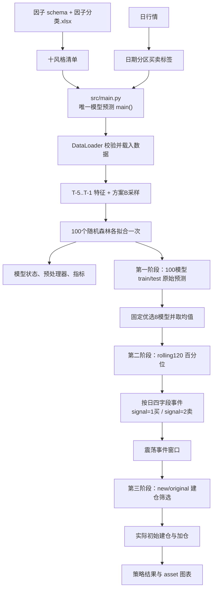

# 模型预测项目

本项目只复现 `model.ipynb` 的方案B五日时序窗口树模型：10 个互斥风格乘以
10 个时间方案，共训练 100 个随机森林。模型不创建 validation；每个模型使用完整
train 拟合一次，并预测 train/test。

文档只保留三个入口：

- 本页：项目流程、配置、数据、输出和设计边界。
- [模型说明](model/index.md)：特征、采样器、模型状态和优选 8 模型。
- [标签、信号与策略](signals.md)：买卖标签、滚动百分位、建仓和加仓策略。

## 运行顺序与完整流程

完整生产流水线只需要从项目根目录执行：

```bash
./run.sh
```

`run.sh` 首先执行 `uv sync --frozen`。如果 `.venv` 不存在，uv 会按照
`.python-version`、`pyproject.toml` 和 `uv.lock` 创建环境并安装锁定依赖；如果环境已
存在，则校验并同步到锁文件状态。运行机器只需要预先安装 `uv`，不需要执行
`python -m venv` 或 `source .venv/bin/activate`。同步完成后，脚本使用
`uv run --no-sync` 依次执行以下阶段，任何阶段失败都会立即停止：

```bash
uv run python scripts/generate_style_manifest.py  # 将原始因子划分为10个类别
uv run python scripts/generate_labels.py  # 标签保存到 output/label/YYYY-MM-DD.parquet
uv run src/main.py                          #运行训练随机森林模型得到100个模型的预测结果
uv run python scripts/build_ensemble_buy_signals.py  # 生成优选8模型的买卖信号
uv run python scripts/run_entry_strategy.py  # 执行建仓持仓策略，曲线保存到 asset
```

`main()` 通过顶层 `Config.load()` 自动读取 `config/config.yaml`，直接完成输入校验、数据载入、特征构建、
采样、100 模型训练、模型及预处理器序列化、train/test 预测和指标保存。项目不再
保留 `src/bin` 薄入口。



## 配置与数据

顶层Pydantic `Config` 是唯一配置入口，所有脚本只调用 `Config.load()`，不自行解析
YAML或重复定义默认路径。默认配置为 `config/config.yaml`；可以设置
`BUY_POINT_CONFIG_PATH` 切换另一份配置，不使用命令行配置参数。所有相对路径均以配置文件目录为基准；YAML只
配置一个 `output` 根目录。`model_prediction/models`、`prediction`、`metrics`、
`signals`、`ensemble_8_models` 和 `strategy` 由 `Config` 属性派生；标签路径则通过
`input.label_path` 显式配置到 `output/label`。方案B不配置验证集。

当前只对确有独立消费边界的数据加载模块保留 `data_config()` 工厂方法，其他紧密耦合
步骤直接读取顶层配置，避免为简单脚本制造重复的子配置类。

| 输入          | 默认来源                                              | 关键字段                                                       |
| ------------- | ----------------------------------------------------- | -------------------------------------------------------------- |
| A500 年度因子 | `input.factor_dir/*.parquet`                        | `datetime`, `order_book_id`, 因子列                        |
| 原始日行情    | `input.price_path`                                  | `trade_date`, `order_book_id`, `close`, `prev_close`   |
| 生成训练标签  | `input.label_path/*.parquet`，默认 `output/label` | `datetime`, `order_book_id`, `buy_label`, `sell_label` |
| 因子分类表    | `input.factor_classification_path`                  | `因子名称`, `利润来源`, 描述字段                           |
| 震荡事件      | `input.event_path`                                  | `trade_date`, `order_book_id`                              |
| 风格清单      | `input.style_manifest_path`                         | `factor_name`, `style_id`, `style_name`；仅含训练期有有限观测的因子 |

`generate_labels.py` 从原始日行情构造复权收盘价并生成日期分区标签。`DataLoader`
随后直接读取 `input.label_path`，将 `datetime` 归一化为 `trade_date`，再按股票和交易日
一对一连接因子与 `buy_label`。每次只加载当前风格需要的因子。

### 全空因子筛选

`generate_style_manifest.py` 在风格分类前检查原始因子的数据覆盖。检查区间只使用当前
配置允许进入全部时间方案训练的数据：采用十个方案中最晚的训练起点，到测试日前完成
标签隔离后的最后一个训练日；当前配置对应 **2020-04-01 至 2022-03-03**（T10 的
8 季度回看窗口）。这样进入公共 manifest 的因子对 T01～T10 都至少存在训练期观测。
2022-04-01 开始的测试数据不参与筛选，
避免测试信息泄漏。如果原始因子在该闭区间内没有任何有限数值（全为 null、NaN 或
正负无穷），该因子不会写入风格清单，其原值、`delta`、`pct_change` 及 T-5 至 T-1
滞后特征也就不会在训练时生成。

当前数据版本删除了以下 32 个因子；审计 CSV 会随输入数据重新生成：

- `mrq0_indicators_disposal_loss_on_asset_mrq_0`
- `mrq0_indicators_other_effecting_total_profits_items_mrq_0`
- `mrq0_indicators_unrealised_investment_loss_mrq_0`
- `mrq0_indicators_other_effecting_net_profits_items_mrq_0`
- `mrq0_indicators_remearsured_other_income_mrq_0`
- `mrq0_indicators_bad_debt_reserve_mrq_0`
- `mrq0_indicators_consumable_biological_assets_mrq_0`
- `mrq0_indicators_deferred_expense_mrq_0`
- `mrq0_indicators_contract_work_mrq_0`
- `mrq0_indicators_accumulated_depreciation_mrq_0`
- `mrq0_indicators_depreciation_reserve_mrq_0`
- `mrq0_indicators_seat_costs_mrq_0`
- `mrq0_indicators_subrogation_fee_receivable_mrq_0`
- `mrq0_indicators_mortgaged_loan_mrq_0`
- `mrq0_indicators_accrued_expense_mrq_0`
- `mrq0_indicators_long_term_liabilities_due_one_year_mrq_0`
- `mrq0_indicators_housing_revolving_funds_mrq_0`
- `mrq0_indicators_financial_lease_payable_mrq_0`
- `mrq0_indicators_security_deposits_received_mrq_0`
- `mrq0_indicators_comission_payable_mrq_0`
- `mrq0_indicators_foreign_currency_converted_difference_mrq_0`
- `mrq0_indicators_uncertained_impairment_losses_mrq_0`
- `mrq0_indicators_other_reserves_mrq_0`
- `mrq0_indicators_draw_back_canceled_loans_mrq_0`
- `mrq0_indicators_cash_received_from_sub_issue_security_mrq_0`
- `mrq0_indicators_other_effecting_cash_equivalent_items_mrq_0`
- `mrq0_indicators_cash_paid_for_comissions_mrq_0`
- `mrq0_indicators_cash_paid_for_orignal_insurance_mrq_0`
- `mrq0_indicators_net_increase_from__financing_buy_back_mrq_0`
- `financial_indicators_depreciation_per_share_ttm`
- `financial_indicators_depreciation_and_amortization_ttm`
- `financial_indicators_operating_cyclez_lyr`

脚本同时生成 `a500_factor_style_manifest_excluded.csv`，逐项保存原分类、检查起止日期和
删除原因，作为可审计记录。这里删除的是“训练期全空”而不是“长期不变”的因子：有值
但长期不变的财报字段仍会保留，其差分通常为 0，并不会触发全空列警告。

### 输出文件说明

| 配置或派生属性                | 默认输出                                                               | 生成阶段与用途                                                                         |
| ----------------------------- | ---------------------------------------------------------------------- | -------------------------------------------------------------------------------------- |
| `input.style_manifest_path` | `output/data/a500_factor_style_manifest.csv`                         | `generate_style_manifest.py` 生成十风格因子清单，模型训练直接读取                    |
| 风格清单删除审计            | `output/data/a500_factor_style_manifest_excluded.csv`                | 记录未进入分类的训练期全空因子、检查区间及删除原因                                  |
| `input.label_path`          | `output/label/YYYY-MM-DD.parquet`                                    | `generate_labels.py` 按交易日生成 `datetime, order_book_id, buy_label, sell_label` |
| `model_prediction_dir`      | `output/model_prediction/`                                           | 保存100个模型的状态、预处理器、配置快照、预测和评估指标                                |
| `models_dir`                | `output/model_prediction/models/<model_id>/`                         | 每个模型保存`model.state`、预处理器、特征统计和训练元数据                            |
| `prediction_dir`            | `output/model_prediction/prediction/{train,test}/YYYY-MM-DD.parquet` | 保存`datetime, order_book_id, model_id, value, target` 原始连续预测                  |
| `metrics_dir`               | `output/model_prediction/metrics/model_metrics.csv`                  | 保存各模型的 Rank IC、RMSE、MAE 等衡量指标                                             |
| `signals_dir`               | `output/model_prediction/signals/*.parquet`                          | `optimize_signals.py` 可选生成100模型逐模型及全模型均值研究基线                      |
| `ensemble_8_models_dir`     | `output/ensemble_8_models/YYYY-MM-DD.parquet`                        | 优选8模型均值经120日百分位阈值划分后的四字段原始买卖事件                               |
| `strategy_dir`              | `output/strategy/`                                                   | 保存震荡事件筛选信号、建仓点、加仓点、卖点、交易、持仓、净值和指标                     |
| 策略图表目录                  | `asset/*.png`                                                        | 保存个股买卖/建仓标记图以及累计收益和组合持仓图                                        |

除风格清单和标签使用YAML显式配置路径外，其余输出目录均由顶层 `output` 根目录通过
`Config` 属性派生。优选8模型与策略输出都是上游结果的后处理，不会修改100模型的
原始预测分区。

## 输出

结果不提交代码仓库，交付时单独打包 `output/`：

```text
output/
├── data/
│   ├── factor/a500_factor/*.parquet       # 外部输入：A500年度因子
│   ├── db_rq_factor/
│   │   ├── 因子分类.xlsx                   # 外部输入：因子分类元数据
│   │   └── trade/1d.parquet               # 外部输入：原始日行情
│   ├── oscillation_signals.xlsx           # 外部输入：策略震荡事件
│   ├── oscillation_signals_filtered.xlsx  # 可选的过滤后震荡事件
│   ├── a500_factor_style_manifest.csv     # generate_style_manifest.py生成
│   └── a500_factor_style_manifest_excluded.csv # 训练期全空因子删除审计
├── model_prediction/
│   ├── resolved_config.json                 # 本次运行解析后的完整配置快照
│   ├── artifact_manifest.csv                # 100个模型及其交付文件索引
│   ├── input_snapshot/style_manifest.csv    # 本次训练实际使用的风格清单快照
│   ├── models/<model_id>/
│   │   ├── model.state                      # 可反序列化的随机森林模型状态
│   │   ├── feature_processor.pkl            # 输入列、裁剪规则和缺失值处理器
│   │   ├── feature_statistics.csv           # 训练集各特征的均值和标准差
│   │   └── metadata.json                    # 训练区间、样本数、参数和模型指标
│   ├── prediction/
│   │   ├── train/YYYY-MM-DD.parquet         # 100模型训练集原始预测结果
│   │   └── test/YYYY-MM-DD.parquet          # 100模型测试集原始预测结果
│   ├── metrics/model_metrics.csv            # Rank IC、RMSE和MAE评价指标
│   └── signals/*.parquet                    # 可选的100模型分析基线
├── ensemble_8_models/
│   └── YYYY-MM-DD.parquet                   # 优选8模型的四字段原始买卖事件
├── label/YYYY-MM-DD.parquet                 # 根据日行情计算的买入和卖出训练标签
└── strategy/                                # 建仓筛选、交易和回测结果
    ├── event_signals.parquet                # 震荡事件窗口内的原始买卖信号
    ├── entry_points.parquet                 # 建仓规则筛选后的理论建仓点
    ├── initial_entry_points.parquet         # 实际执行的初始建仓信号
    ├── add_on_points.parquet                # 实际执行的加仓信号
    ├── sell_points.parquet                  # 仅落盘和绘图、不参与退出的卖点
    ├── executed_buys.parquet                # 含价格、数量和金额的实际买入明细
    ├── trades.parquet                       # 买入、卖出、止盈止损和调仓流水
    ├── portfolio.parquet                    # 每日现金、组合净值和持仓数量
    ├── weights.parquet                      # 每日逐股票持仓市值和权重
    └── metrics.json                         # 最终净值、最大回撤和交易数量指标
```

`output/data` 是流水线运行前必须准备的数据包；`run.sh` 不会生成原始因子、日行情、
因子分类表或震荡事件，只会依据这些输入重新生成风格清单、标签和后续模型结果。
`input.event_path` 当前指向未过滤的 `output/data/oscillation_signals.xlsx`；如需使用过滤
版本，应在配置中显式切换。

图表不放进模型数据输出目录，统一写入：

```text
asset/
├── oscillation_event_buy_sell_entry_points.png #买入卖出点的曲线图
└── strategy_cumulative_returns_portfolio_holdings.png #根据建仓条件筛选出来的买入持有策略以及对应的收益图
```

标签分区 schema 为 `datetime, order_book_id, buy_label, sell_label`；预测分区 schema
为 `datetime, order_book_id, model_id, value, target`。模型指标包括单股时序
Spearman、股票等权 RMSE/MAE 和面板 RMSE/MAE。

三阶段的边界为：`prediction/test` 保存100模型连续值；`ensemble_8_models` 保存八模型
均值经过百分位阈值划分后的原始事件；`strategy` 保存震荡事件和建仓规则筛选后的真实
策略输入、实际买入及回测结果。

## 设计边界

- `src/main.py` 是唯一模型预测入口和编排函数。
- `src/buy_point_project/` 是内部业务包，分别保存配置、数据、特征、采样、模型、
  预处理、训练、预测、指标和 IO 实现。
- `scripts/` 保存标签生成、信号优化和策略等训练前后可独立执行的研究脚本。
- Config 只暴露一个输出根路径，再由属性生成所有具体输出目录。
