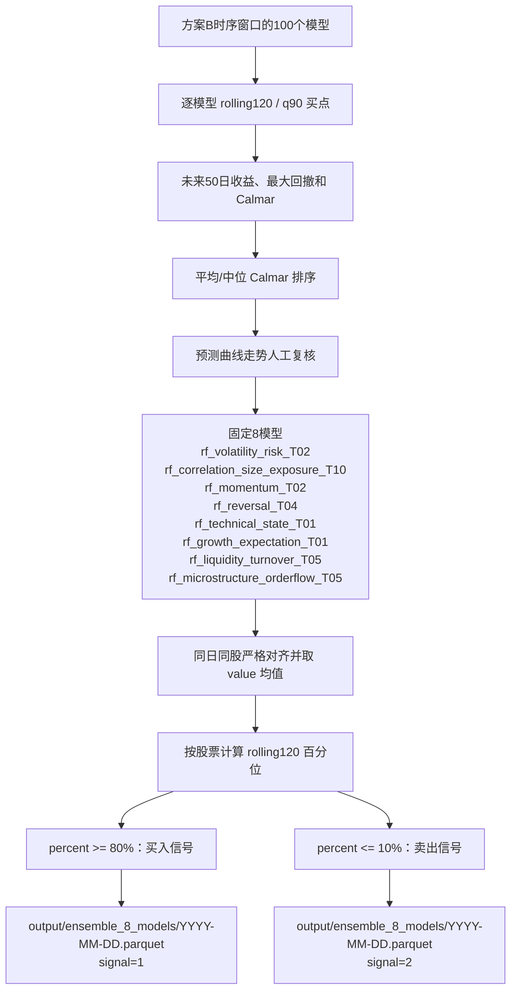

# 模型预测

模型预测由外层 `src/main.py` 的 `main()` 进入，并直接完成数据校验、特征构建、采样、
训练、持久化、预测和指标写出。

对应源码职责为：`data.py` 加载数据，`feature.py` 构建特征，`sampler.py` 构建
样本和权重，`model.py` 定义模型及状态格式，`train.py` 执行训练与交付。

## 1.1 特征构建

先运行 `uv run python scripts/generate_style_manifest.py`。
该脚本读取 A500 因子 Parquet 的 schema 和配置中的 `因子分类.xlsx`，沿用原
`model.ipynb` 的元数据优先、关键词兜底规则，将因子唯一划分到十种风格，并写入
`output/data/a500_factor_style_manifest.csv`。模型训练直接读取这份生成结果。

每个风格只读取清单中属于自己的基础因子。`mrq0_` 和 `financial_` 财务列先在连续
单股时间轴计算 `delta` 与 `pct_change`，然后和基础因子一起生成 T-5、T-4、T-3、
T-2、T-1 五组输入；目标日 T 的因子不进入模型。窗口特征必须在日期抽样前生成。

数值进入预处理器前统一转为 float32，非数值与无穷值置空，极端有限值按配置裁剪。

## 1.2 采样器构建

按完整交易日历在每季度确定性等距选择最多 12 个训练日，并在测试期开始前
隔离 20 个交易日，避免训练标签的未来窗口进入 test。每个时间方案再按 lookback
截取 train，或通过季度半衰期调整样本权重；季度内样本共享季度总权重。

模型不创建 validation，也不进行超参数选择。每个 `style_id × time_id` 使用完整
train 拟合一次，随后用同一个模型预测 train 和 test。

## 1.3 模型结构与状态

每个配置使用 `RandomForestRegressor`：120 棵树、叶节点最少 25 个样本、
`max_features=sqrt`、固定随机种子。缺失值由训练集拟合的中位数填充器处理，并增加
缺失指示列。

每个 `models/<model_id>/` 包含：

- `model.state`：格式版本、模型配置和随机森林状态，可反序列化恢复。
- `feature_processor.pkl`：输入列、裁剪口径、中位数填充器、训练集均值和标准差。
- `feature_statistics.csv`：均值和标准差的可读审计表。
- `metadata.json`：训练区间、样本数和 train/test 指标。

复现时必须配对加载同一模型目录的预处理器与 `model.state`，先执行
`processor.transform(frame)`，再执行 `model.predict(features)`。

最终对十个互斥风格分别训练 T01~T10，共 100 个模型。每个模型都使用相同测试
区间，但使用不同的历史窗口或季度半衰期权重。

## 100 模型评估与优选 8 模型组合

原 Notebook 对“方案B-时序窗口”的 100 个模型分别执行以下评估：每只股票使用
包含当天的 120 条预测计算 90% 分位买点，以 T+1 成交价为基准观察未来 50 个交易日，
并按“未来窗口最大收益 / 未来窗口最大回撤绝对值”计算买点 Calmar。模型级结果来自
`fixed_test_rolling120_q90_50d_calmar_metrics.csv`。

候选模型先按平均和中位未来 Calmar 排序，再结合预测曲线走势进行人工复核。因此最终
名单是“Calmar 排序 + 预测曲线走势筛选+因子风格筛选”的结果，不是简单截取平均 Calmar 前 8 名；
固定名单恰好覆盖 8 种模型风格。下表排名是在该方案的 100 个模型内计算：

| 优选模型                             | 时间方案             | 平均 Calmar（排名） | 中位 Calmar（排名） | 平均未来50日收益 | 90%买点数 |
| ------------------------------------ | -------------------- | ------------------: | ------------------: | ---------------: | --------: |
| `rf_volatility_risk_T02`           | 全历史，季度半衰期32 |       1.365744（1） |       0.832025（1） |         0.043407 |    56,990 |
| `rf_correlation_size_exposure_T10` | 最近8个季度          |       1.347521（5） |       0.799402（7） |         0.031108 |    71,052 |
| `rf_technical_state_T01`           | 全历史，季度等权     |      1.330892（11） |      0.776335（18） |         0.040260 |    59,138 |
| `rf_momentum_T02`                  | 全历史，季度半衰期32 |      1.328958（14） |      0.780000（15） |         0.038695 |    59,113 |
| `rf_reversal_T04`                  | 全历史，季度半衰期8  |      1.313958（22） |      0.773371（22） |         0.037239 |    57,947 |
| `rf_growth_expectation_T01`        | 全历史，季度等权     |      1.301668（34） |      0.775336（19） |         0.037155 |    83,223 |
| `rf_microstructure_orderflow_T05`  | 全历史，季度半衰期4  |      1.239344（75） |      0.679349（89） |         0.025534 |    80,015 |
| `rf_liquidity_turnover_T05`        | 全历史，季度半衰期4  |      1.233199（79） |      0.710115（73） |         0.026730 |    69,686 |

优选组合脚本为 `scripts/build_ensemble_buy_signals.py`。它先确认输入确实包含 100 个
模型，再要求每个股票交易日完整集齐以上 8 个模型；随后对 8 个 `value` 做算术平均，
按股票计算最近 120 条组合预测的滚动百分位。生产信号默认采用 `percent >= 0.80`
作为买点、`percent <= 0.10` 作为卖点。这里的 80% 生产阈值和上面的 90% 模型评估
阈值用途不同。

固定 8 模型为：`rf_volatility_risk_T02`、
`rf_correlation_size_exposure_T10`、`rf_momentum_T02`、`rf_reversal_T04`、
`rf_technical_state_T01`、`rf_growth_expectation_T01`、
`rf_liquidity_turnover_T05`、`rf_microstructure_orderflow_T05`。

融合连续均值和百分位只作为脚本内部中间量，不单独落盘。最终每个买卖事件展开成8行，
用原始 `model_id` 保留来源模型，固定输出字段为
`datetime, order_book_id, model_id, signal`。
